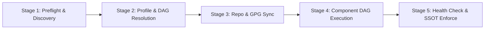

# Thiết Kế Kiến Trúc & Đặc Tả Hệ Thống Cài Đặt VDE-Install

> Luồng thực thi hiện tại: chạy tool trên chính server standalone hoặc một node HA. Standalone luôn local; HA khai báo đúng một host `local: true`, các host khác được điều phối qua SSH. Preflight xác minh IP local trước khi cài. Xem README và runbook-walkthrough.md cho cấu hình/lệnh hiện tại. Các khả năng production nêu trong thiết kế cần được kiểm chứng riêng theo source/runtime.

- **Dự án:** VNPT DB Engine (VDE) Tooling
- **Phiên bản kiến trúc:** 2.0 (Chốt phương án thực thi)
- **Cơ chế quản lý cấu hình:** Single Source of Truth (SSOT) — VDE Enforces & Overwrites Drift
- **Ngôn ngữ thực thi:** **Python 3** (Python DAG Orchestrator + Native SSH)
- **Baseline Components:** PostgreSQL 16, Patroni 4.0, etcd 3.5+, PgBouncer 1.22+, HAProxy 2.8+, Keepalived (VIP tùy chọn), pgBackRest 2.50+, PMM Server/Client 3.10 (standalone local server), Citus 14 readiness.
- **Hệ điều hành mục tiêu:** RHEL / Rocky Linux / AlmaLinux 8 & 9 (x86_64).

---

## 1. Tổng Quan Kiến Trúc (Architecture Overview)

Công cụ `vde-install` là bộ điều phối cài đặt và quản trị vòng đời cho hệ thống cơ sở dữ liệu phân tán chuẩn doanh nghiệp. Thay vì kế thừa bộ Ansible roles đồ sộ và cồng kềnh của Pigsty, `vde-install` được phát triển theo triết lý **tinh gọn, độc lập và kiểm soát tuyệt đối**:

1. **Khung cài đặt điều phối theo đồ thị DAG (Directed Acyclic Graph):**
   Các bước cài đặt được mô hình hóa thành component DAG trong inventory.py. Hai profile dùng cùng khung Patroni + etcd; node local chạy shell trực tiếp, node remote chạy qua native SSH. Executor hiện thực thi tuần tự theo component/host.
2. **Triết lý Single Source of Truth (SSOT):**
   YAML là cấu hình mong muốn. baseline.json schema 3 lưu một hash cho mỗi component sau khi component đó apply xong, kể cả apply theo tag; enforce chỉ báo và (khi không có `-t`/`--force`) chỉ reconcile component đang lệch. Schema 2 còn khớp được nâng lên schema 3 ở lần ghi sau. Source chưa đọc toàn bộ file/DCS/runtime để phát hiện sửa tay. Đồng bộ đầy đủ Desired/Observed/Baseline/Effective vẫn cần hoàn thiện.
3. **Cơ chế Ưu Tiên Cấu Hình (User Overrides > Smart Defaults):**
   - **Người dùng tự định nghĩa (User Explicit Settings):** Người dùng có toàn quyền khai báo tự do bất kỳ tham số PostgreSQL GUC nào (`parameters`), thông số kernel (`sysctl`) hoặc cổng mạng (`ports`). Các giá trị người dùng tự đặt **LUÔN CÓ ĐỘ ƯU TIÊN CAO NHẤT**.
   - **Smart Defaults chỉ là tùy chọn phụ (Auxiliary Fallback):** Được bật/tắt linh hoạt qua cờ `auto_tune: true | false`. Smart Defaults chỉ đóng vai trò là "lưới bảo vệ" tự động điền các tham số an toàn cho những giá trị mà người dùng **chưa khai báo**, giúp người dùng không bắt buộc phải viết hàng trăm dòng cấu hình nếu không có nhu cầu đặc thù.
4. **Tích hợp kho RPM Repo nội bộ (`dbengine-repo.ttpmhcm.com`):**
   Tương thích 100% với môi trường Air-Gapped (mạng cô lập viễn thông). Từng node client tự động kết nối và tải các gói RPM đã ký số GPG (`RPM-GPG-KEY-VNPT-DB-ENGINE`) từ máy chủ Repo Nginx nội bộ với tốc độ LAN.
5. **Giám sát chuẩn hóa qua PMM (Percona Monitoring and Management):**
   Loại bỏ stack Prometheus / Grafana / Loki đồ sộ của Pigsty; chuẩn hóa PMM 3: standalone cài PMM Server container + Client trên cùng node; HA dùng Client kết nối PMM Server riêng. Chi tiết triển khai và phạm vi collector: [PMM standalone](pmm-standalone.md).

---

## 2. Mô Hình Phân Tầng & Luồng Hoạt Động (Layered Architecture)

```mermaid
flowchart TB
    subgraph ControlPlane ["Tool trên node local trong cụm"]
        Spec["vde-cluster.yml\n(Minimal SSOT Spec ~25 lines)"]
        CLI["vde-install CLI (Python 3)\n(validate | plan | apply | enforce | status)"]
        Inventory["Inventory & Smart Defaults Calculator\n(Auto-tuning GUC based on HW & OLTP/OLAP)"]
        DAGEngine["Component DAG Engine\n(Topological Sort & Dependency Resolution)"]
        SSHRunner["Local Shell + Native SSH\n(Sequential Execution & Live Stream)"]
        StateEnforcer["SSOT State Enforcer\n(SHA256 Hash Tracking & Drift Overwrite)"]

        Spec --> CLI
        CLI --> Inventory --> DAGEngine --> SSHRunner
        CLI --> StateEnforcer
    end

    subgraph RepoServer ["Private Repo Server (14.225.238.14)"]
        RPMRepo["Local YUM/DNF Repo (Nginx HTTP :80)\n/vnpt-db-engine/el9/x86_64/"]
        GPGKey["GPG Public Key\n/RPM-GPG-KEYS/RPM-GPG-KEY-VNPT-DB-ENGINE"]
    end

    subgraph TargetCluster ["Target DB Cluster (Nodes 1..N)"]
        direction TB
        Node1["Node 1 (Primary / Balancer)"]
        Node2["Node 2 (Sync Standby / Balancer)"]
        Node3["Node 3 (Async Standby / etcd Quorum)"]
    end

    SSHRunner -->|Local Execution / SSH tới các node khác| TargetCluster
    TargetCluster -->|HTTP Port 80 (Pull RPMs & GPG Key via LAN)| RepoServer
```

---

## 3. Vòng Đời Thực Thi 5 Giai Đoạn (The 5-Stage Pipeline)



1. **Stage 1 — Preflight & Discovery:**
   - Đọc RAM/vCPU/interface trên node local trước, kiểm tra IP khớp inventory, sau đó đọc các node khác qua SSH.
   - Cài thật cần root hoặc sudo không tương tác. Chưa tự kiểm tra đầy đủ disk, OS, SELinux, firewall.
2. **Stage 2 — Profile & DAG Resolution:**
   - Đọc tệp `vde-cluster.yml`, xác định profile (`standalone` hoặc `ha`).
   - Dựng DAG trong core/inventory.py; standalone đúng một host local, HA đúng một host local và các host remote.
3. **Stage 3 — Repo & GPG Sync:**
   - Kích hoạt component `local_repo`: Thiết lập tệp `/etc/yum.repos.d/vnpt-db-engine.repo`.
   - Tải và import khóa ký số GPG nội bộ, làm mới bộ đệm DNF (`dnf clean all && dnf makecache`).
4. **Stage 4 — Component DAG Execution:**
   - Thực thi tuần tự các component và host theo thứ tự topo của DAG:
     * `os_baseline` $\rightarrow$ `local_repo` $\rightarrow$ `etcd` $\rightarrow$ `postgresql16` $\rightarrow$ `patroni` $\rightarrow$ `pgbouncer` $\rightarrow$ `haproxy` $\rightarrow$ `keepalived` *(chỉ khi bật `settings.keepalived`)* $\rightarrow$ `pgbackrest` $\rightarrow$ `pmm`.
5. **Stage 5 — Health Check & SSOT Enforce:**
   - Kiểm tra dịch vụ hệ thống và REST API của Patroni (`:8008`), PgBouncer (`:6432`), HAProxy (`:5433` write, `:5434` read) và Keepalived (VIP đang nằm trên node nào) khi được bật.
   - Tính toán checksum SHA256 của toàn bộ cấu hình, khóa mốc SSOT Baseline để phục vụ phát hiện và tự động ghi đè drift.

---

## 4. Ma Trận Component Giữa 2 Profile

| Component | V1: Standalone Profile | V2: High Availability & DR Profile |
|---|---|---|
| **Số lượng Node tối thiểu** | 1 Node vật lý / VM | $\ge$ 3 Nodes (DB + etcd quorum) |
| **`os_baseline`** | sysctl kernel, limits, POSIX ACL cho `/data` | Tương tự V1 + cấu hình SSH key trust |
| **`local_repo`** | Trỏ Repo `http://dbengine-repo.ttpmhcm.com` | Trỏ Repo `http://dbengine-repo.ttpmhcm.com` |
| **`etcd`** | Một node local | Các host role etcd; source chưa triển khai mTLS |
| **`postgresql16`** | Cài RPM; Patroni bootstrap local | Cài RPM, Patroni bootstrap/clone |
| **Supervisor** | Patroni | Patroni |
| **`pgbouncer`** | Local port 6432, `pool_mode = transaction` | Port 6432 trên từng node DB hoặc balancer |
| **`haproxy`** | Có thể bật; endpoint replica không có backend | Port 5433 (Write), Port 5434 (Read-only) |
| **`keepalived`** | Tắt (một node không cần VIP) | Tùy chọn: một VIP phía trước HAProxy trên các node role `balancer`, VRRP unicast, `chk_haproxy` kiểm tra cổng write; client dùng `VIP:5433` / `VIP:5434` |
| **`pgbackrest`** | Local stanza (`/data/backup`), crontab backup | Multi-repo: Local + Remote / S3 MinIO |
| **`pmm`** | `pmm-client` kết nối PMM Server | `pmm-client` giám sát PostgreSQL + host; Patroni/PgBouncer/HAProxy/etcd collectors chưa tự đăng ký |
| **Citus 14 Readiness** | Không sử dụng | Sẵn sàng mở rộng Coordinator/Worker DAG |

---

## 5. Cấu Trúc Thư Mục Repository `install-tool`

```text
install-tool/
├── documents/                           # Tài liệu kỹ thuật, hướng dẫn và đặc tả
│   ├── architecture-and-design.md       # Báo cáo kiến trúc và đặc tả tổng hợp (Tệp này)
│   ├── cluster-config-reference.md      # Đặc tả schema manifest YAML (SSOT)
│   ├── python-environment.md            # Thiết lập Python .venv, xử lý lỗi & wheel offline
│   ├── runbook-walkthrough.md           # Hướng dẫn triển khai Standalone/HA & vận hành Day-2
│   ├── cleanup-guide.md                 # Hướng dẫn kiểm kê và gỡ cài đặt cục bộ (cleanup)
│   └── pmm-standalone.md                # Cấu hình và nghiệm thu giám sát PMM 3
├── bin/
│   └── vde-ins                          # Wrapper chạy src/main.py (.venv → python3.12 → python3)
├── src/                                 # Mã nguồn thực thi công cụ VDE-Install
│   ├── main.py                          # CLI Entrypoint (vde-install)
│   ├── config/
│   │   ├── vde-cluster.example.yml      # HA: đánh dấu đúng một local host
│   │   └── standalone.example.yml       # Một host, chạy cục bộ
│   ├── core/
│   │   ├── __init__.py
│   │   ├── inventory.py                 # Parser spec YAML & Smart Defaults GUC Calculator
│   │   ├── engine.py                    # Component DAG Engine (Topological Sort)
│   │   ├── platform_check.py            # Kiểm tra nền tảng, OS, firewalld (kể cả vrrp), đồng hồ
│   │   ├── ssh_runner.py                # Local shell và SSH tới node remote
│   │   ├── execution.py                 # Thực thi pipeline & thứ tự db_ready
│   │   ├── state_enforcer.py            # SSOT Enforcer & Drift Detection
│   │   ├── pmm.py                       # Cấu hình, kiểm tra & ngân sách RAM cho PMM 3
│   │   └── cleanup.py                   # Kiểm kê và gỡ cài đặt interactive
│   └── components/                      # Các module shell script độc lập & idempotent
│       ├── os_baseline/
│       ├── local_repo/
│       ├── etcd/
│       ├── postgresql16/
│       ├── patroni/
│       ├── pgbouncer/
│       ├── haproxy/
│       ├── keepalived/
│       ├── pgbackrest/
│       ├── pmm_server/
│       └── pmm/
└── README.md                            # Hướng dẫn sử dụng nhanh
```


Luồng thực thi cập nhật: `Patroni -> db_ready (DCS/reload ack/restart/SQL/extensions) -> access (PgBouncer/HAProxy -> Keepalived VIP nếu bật)/backup + PMM Server -> PMM Client -> full baseline`. Xem [PMM standalone](pmm-standalone.md) cho tag semantics, ngân sách RAM và dependency offline.
